# ENNOVA Class Diagram

This diagram represents the implemented domain, account, policy-language, writing-mode, access-control, and grounded-Q&A classes. Module-level functions and Prolog predicates are identified in notes instead of being presented as Python classes.

```mermaid
classDiagram
    class Owner {
        -str _owner_id
        -str _name
        -Vault _vault
        -Protocol _protocol
        +owner_id str
        +name str
        +vault Vault
        +protocol Protocol
    }
    class Beneficiary {
        -str _beneficiary_id
        -str _name
        -Protocol __protocol
        +beneficiary_id str
        +name str
        +protocol Optional~Protocol~
    }
    class Protocol {
        -list~Grant~ _grants
        +add_grant(grant) None
        +grants tuple
    }
    class Grant {
        -str _beneficiary_id
        -str _selector
        -AccessLevel _access_level
        +beneficiary_id str
        +selector str
        +access_level AccessLevel
    }
    class DiaryAccessLevel["AccessLevel (diary model enum)"] {
        <<enumeration>>
        EXISTENCE
        SUMMARY
        VERBATIM
    }
    class PolicyAccessLevel["AccessLevel (policy bridge type alias)"] {
        <<type alias>>
        existence
        summary
        verbatim
    }
    class Vault {
        -list~Entry~ __entries
        -set~str~ __entry_ids
        +append(entry) None
        +get(entry_id) Entry
        +entries tuple
    }
    class Entry {
        <<abstract>>
        -str _entry_id
        -datetime _created_at
        -str _original_content
        -tuple~str~ _tags
        +entry_id str
        +created_at datetime
        +original_content str
        +tags tuple~str~
        +kind str
        +describe() str
        +summarize() str
    }
    class DiaryEntry {
        +kind str
    }
    class LetterEntry {
        -str _title
        -str _recipient
        -date _release_date (required)
        +title str
        +recipient str (required)
        +release_date date (required)
        +kind str
    }
    class StoredEntry {
        +str owner_id
        +Entry entry
        +tuple names
        +tuple topics
        +ChainedEntry chain_entry
    }
    class EntryRepository {
        <<interface>>
        +append(record) None
        +get(owner_id, entry_id) StoredEntry
        +list_for_owner(owner_id) tuple
        +head_hash(owner_id) str
    }
    class InMemoryEntryRepository {
        -dict _entries
        -dict _entry_ids
        +append(record) None
        +get(owner_id, entry_id) StoredEntry
        +list_for_owner(owner_id) tuple
        +head_hash(owner_id) str
    }
    class SQLAlchemyEntryRepository {
        +append(record) None
        +get(owner_id, entry_id) StoredEntry
        +list_for_owner(owner_id) tuple
        +head_hash(owner_id) str
    }
    class DiaryService {
        -EntryRepository _repository
        +add_diary_entry(owner_id, entry_id, original_content, timestamp, people) StoredEntry
        +add_letter_entry(owner_id, entry_id, original_content, title, recipient, timestamp, people) StoredEntry
        +get_entry(owner_id, entry_id) StoredEntry
        +list_entries(owner_id) tuple
        +verify(owner_id, expected_head) bool
    }
    class EntryData {
        +str original_content
        +datetime timestamp
        +tuple metadata
    }
    class ChainedEntry {
        +EntryData entry
        +str previous_hash
        +str digest
    }
    class UserAccount {
        +str account_id
        +str username
        +str email
        +str owner_id
        +str person_id
        +AccountRole role
        +str password_hash
    }
    class Invitation {
        +str code_hash
        +str owner_id
        +str person_id
        +datetime expires_at
        +bool used
    }
    class AccountRole {
        <<enumeration>>
        OWNER
        BENEFICIARY
    }
    class UserRepository {
        <<interface>>
        +add_user(account, invitation) None
        +get_by_username(username) UserAccount
        +get_by_account_id(account_id) UserAccount
        +list_for_owner(owner_id) tuple
        +add_invitation(invitation) None
        +find_invitation(code_hash) Invitation
    }
    class InMemoryUserRepository {
        -dict _accounts
        -dict _usernames
        -dict _owner_people
        -dict _emails
        -list _invitations
        +add_user(account, invitation) None
        +get_by_username(username) UserAccount
        +get_by_account_id(account_id) UserAccount
        +list_for_owner(owner_id) tuple
        +add_invitation(invitation) None
        +find_invitation(code_hash) Invitation
    }
    class AuthService {
        -UserRepository _repository
        +register_owner(username, email, password) UserAccount
        +create_invitation(owner_id, person_id, expires_at) str
        +redeem_invitation(invitation_code, username, email, password) UserAccount
        +login(username, password) str
        +account_from_token(token) UserAccount
        +registered_person_ids(owner_id) tuple
    }
    class WritingMode {
        <<abstract>>
        +name str
        +process(entry) DerivedVersion
    }
    class Verbatim {
        +name str
        +process(entry) DerivedVersion
    }
    class LightFix {
        -tuple _correction_rules
        +name str
        +process(entry) DerivedVersion
    }
    class Review {
        -tuple _correction_rules
        -bool _rewrite
        +name str
        +process(entry) DerivedVersion
    }
    class DerivedVersion {
        +str source_entry_id
        +str source_digest
        +str mode_name
        +str text
        +tuple changes
        +tuple suggestions
    }
    class InMemoryDerivedVersionStore {
        -list _versions
        +append(version, sequence_number) StoredDerivedVersion
        +list_all() tuple
        +matches_current(version, entry) bool
    }
    class Policy {
        +tuple statements
    }
    class ProtocolBlock {
        +str person
        +tuple statements
    }
    class MayRead {
        +str level
        +Selector selector
    }
    class MaySeeExistence {
        +Selector selector
    }
    class MayNotRead {
        +str level
        +Selector selector
    }
    class MayNotSeeExistence {
        +Selector selector
    }
    class Selector {
        <<marker>>
    }
    class MentioningSelector {
        +str name
    }
    class TaggedSelector {
        +str tag
    }
    class ReleaseLetter {
        +str title
        +str person
        +date release_date
    }
    class Trustee {
        +str person
    }
    class TransferCustody {
        +str person
        +int unavailable_days
    }
    class DefaultWritingMode {
        +str mode
    }
    class Parser {
        -tuple _tokens
        -int _position
        +parse_program() Policy
    }
    class Token {
        +TokenKind kind
        +str value
        +int line
        +int column
    }
    class TokenKind {
        <<enumeration>>
        KEYWORD
        IDENT
        INVALID_IDENTIFIER
        STRING
        DATE
        INTEGER
        COLON
        GE
        NEWLINE
        INDENT
        DEDENT
        EOF
    }
    class PrologAccessBridge {
        -str _executable
        -float _timeout_seconds
        +can_access(policy, app_facts, request) AccessDecision
        +can_access_many(policy, app_facts, requests) tuple
        +evaluate_many(policy, app_facts, access_requests, letter_status_requests) AccessBatchResult
    }
    class AppFacts {
        +tuple registered_people
        +bool death_triggered
        +bool policy_frozen
        +tuple entries
        +tuple entry_mentions
        +tuple entry_tags
        +tuple letters
    }
    class AccessRequest {
        +str person
        +str entry_id
        +PolicyAccessLevel level
        +date today
    }
    class GroundedQAService {
        -DiaryService _diary_service
        -PrologAccessBridge _bridge
        -ModelClient _model_client
        -SummaryStore _summary_store
        +answer(question, owner_id, asker, policy_source, app_facts, today) GroundedResponse
    }
    class OwnerGroundedQAService {
        -DiaryService _diary_service
        -ModelClient _model_client
        -OwnerConversationStore _conversations
        +answer(question, owner_id, today, conversation_id) OwnerAnswer
    }
    class OwnerConversationStore {
        -dict _conversations
        +start_or_load(owner_id, conversation_id) tuple
        +record_question(owner_id, conversation_id, question) None
    }
    class SQLAlchemyOwnerConversationStore {
        +start_or_load(owner_id, conversation_id) tuple
        +record_question(owner_id, conversation_id, question) None
    }
    class OwnerAnswer {
        +GroundedResponse response
        +str conversation_id
        +bool no_record
    }
    class ToolContext {
        +str owner_id
        +str asker
        +date today
        +tuple entries
        +Mapping permissions
        +frozenset verified_entry_ids
        +SummaryStore summaries
    }
    class EntryView {
        +str entry_id
        +date entry_date
        +PolicyAccessLevel level
        +str content
    }
    class GroundedResponse {
        +str text
        +tuple citations
        +str disclaimer
    }
    class ModelClient {
        <<interface / Protocol>>
        +complete(prompt) ModelResponse
    }

    Entry <|-- DiaryEntry
    Entry <|-- LetterEntry
    WritingMode <|-- Verbatim
    WritingMode <|-- LightFix
    WritingMode <|-- Review
    Owner "1" *-- "1" Vault : owns
    Owner "1" *-- "1" Protocol : defines
    Beneficiary "0..*" --> "0..1" Protocol : associated with
    Vault "1" o-- "0..*" Entry : contains
    Protocol "1" *-- "0..*" Grant : holds
    Grant --> Beneficiary : identifies
    Grant --> DiaryAccessLevel : labels
    StoredEntry *-- Entry : wraps original
    StoredEntry *-- ChainedEntry : hash record
    ChainedEntry *-- EntryData : hashes
    EntryRepository <|.. InMemoryEntryRepository
    EntryRepository <|.. SQLAlchemyEntryRepository
    InMemoryEntryRepository ..> StoredEntry
    DiaryService --> EntryRepository : uses
    SQLAlchemyEntryRepository ..> DiaryEntryRecord : persists
    DiaryService ..> DiaryEntry : creates
    DiaryService ..> LetterEntry : creates
    AuthService --> UserRepository : uses
    UserRepository <|.. InMemoryUserRepository
    UserAccount --> AccountRole
    UserRepository o-- Invitation : stores
    WritingMode ..> StoredEntry : processes
    WritingMode ..> DerivedVersion : returns
    InMemoryDerivedVersionStore o-- DerivedVersion : stores
    Policy *-- ProtocolBlock : contains
    Policy o-- ReleaseLetter
    Policy o-- Trustee
    Policy o-- TransferCustody
    Policy o-- DefaultWritingMode
    ProtocolBlock o-- MayRead
    ProtocolBlock o-- MaySeeExistence
    ProtocolBlock o-- MayNotRead
    ProtocolBlock o-- MayNotSeeExistence
    MayRead --> Selector
    MaySeeExistence --> Selector
    MayNotRead --> Selector
    MayNotSeeExistence --> Selector
    Selector <|-- MentioningSelector
    Selector <|-- TaggedSelector
    Parser ..> Token : consumes
    Token --> TokenKind
    PrologAccessBridge ..> Policy : interprets
    PrologAccessBridge ..> AppFacts : serializes
    PrologAccessBridge ..> AccessRequest : evaluates
    GroundedQAService --> DiaryService : enumerates records
    GroundedQAService --> PrologAccessBridge : authorizes
    GroundedQAService ..> ModelClient : supplies prepared prompts
    GroundedQAService ..> ToolContext : builds after decisions
    ToolContext o-- EntryView : tools return views
    OwnerGroundedQAService --> DiaryService : lists authenticated owner's records
    OwnerGroundedQAService --> ModelClient : sends owner-specific prompt
    OwnerGroundedQAService --> OwnerConversationStore : bounded owner-bound context
    OwnerConversationStore <|.. SQLAlchemyOwnerConversationStore
    SQLAlchemyOwnerConversationStore ..> OwnerConversationRecord : persists
    OwnerGroundedQAService ..> EntryView : creates verified retrieved views
    OwnerGroundedQAService ..> GroundedResponse : validates presented citation IDs
    OwnerAnswer *-- GroundedResponse : returns answer and citations

    note for Owner "Domain owner value object; the Flask owner account is UserAccount with role OWNER."
    note for OwnerGroundedQAService "Separate from beneficiary GroundedQAService; retrieves only the authenticated owner's verified records and does not call Prolog."
    note for OwnerConversationStore "In-memory test/demo implementation; production persists at most four owner-bound questions in SQL. No client-supplied assistant history."
    note for Grant "Domain grant data is not the Prolog evaluator. Access decisions are made by access_rules.pl."
    note for Parser "parse(source) calls module function lex(source), then Parser.parse_program(). No Lexer class exists."
    note for WritingMode "Modes and policy resolution exist, but the owner entry API does not select or apply a mode yet."
```

`Owner`/`Vault`/`Protocol` are the original domain model and should not be confused with the account and repository-backed route flow. The working diary save path uses `DiaryService` and `EntryRepository`; the current Flask factory uses `InMemoryEntryRepository`. Registered users and invitations use a separate `UserRepository` abstraction, with MySQL-backed account persistence in the normal application configuration. The Legacy Policy AST compiles through the Python-Prolog bridge; Prolog's actual facts and decision predicates are `registered/1`, `entry/2`, `entry_tag/2`, `grant/3`, `deny/3`, and `can_access/5`, not additional Python classes. Trustee and custody policy nodes exist, but trustee operation is not implemented.
