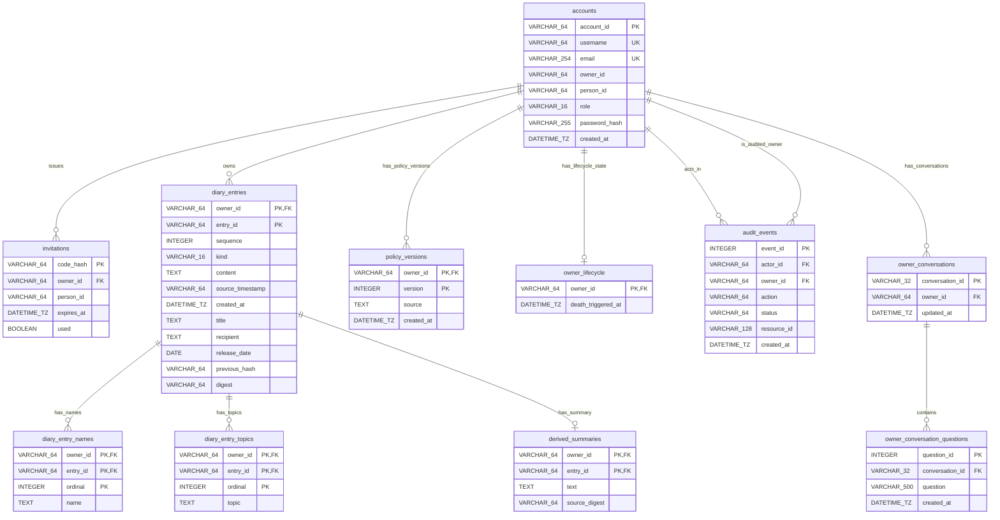

# ENNOVA Entity Relationship Diagram

This ERD documents the relational schema represented by the current SQLAlchemy
models and Alembic migrations. It does not turn domain objects, Prolog facts, or
in-memory stores into database tables.

## Relational schema

The diagram's type tokens expand as follows: `VARCHAR_n` means SQL
`VARCHAR(n)`; `DATETIME_TZ` means SQLAlchemy `DateTime(timezone=True)`; and
`INTEGER`, `TEXT`, `DATE`, and `BOOLEAN` are the corresponding SQLAlchemy
types. The model/migration source is authoritative for nullability and defaults:

- All columns are non-null unless listed below as nullable.
- `accounts.created_at` has a database current-timestamp default.
- `invitations.used` defaults to false.
- `diary_entries.title`, `recipient`, and `release_date` are nullable. The
  domain requires title, recipient, and release date for a `LetterEntry`, but
  the shared table allows them to be null for diary rows; the database does not
  have a conditional constraint enforcing letter metadata.
- `audit_events.resource_id` is nullable.
- `diary_entries` has `UNIQUE(owner_id, sequence)` and a check restricting
  `kind` to `diary` or `letter`.
- `accounts.username` and `accounts.email` are individually unique;
  `(owner_id, person_id)` is unique.
- `policy_versions` is keyed by `(owner_id, version)`, so an owner may have
  multiple versions while a version number is unique for that owner.
- `owner_lifecycle.owner_id` is both the primary key and a foreign key, so an
  account has at most one lifecycle row. Its presence represents a triggered
  death state; `death_triggered_at` records when it was triggered.
- `owner_conversation_questions.conversation_id` has `ON DELETE CASCADE` to
  `owner_conversations.conversation_id`.

## Content, processing, and integrity

`diary_entries.content` stores the original entry text. It is separate from
`derived_summaries.text`, a replaceable generated summary linked to the source
entry by `(owner_id, entry_id)` and associated with the source `digest` through
`source_digest`. A summary is optional for an entry, and each stored summary
belongs to exactly one entry. Summary text is not a writing-mode version.

`previous_hash` and `digest` are columns on `diary_entries`, alongside the
owner-scoped `sequence`. The database stores the links and sequence but does
not declare a foreign key from one entry's `previous_hash` to another row's
`digest`; chain continuity is verified by application logic. `source_timestamp`
preserves the serialized timestamp used by the hash input, while `created_at`
is the database datetime column.

The `WritingMode` implementations return immutable `DerivedVersion` values,
and `InMemoryDerivedVersionStore` keeps them in memory. The current class
diagram states that writing modes are not wired into the owner entry API. No
relational table currently persists those versions, so they are deliberately
not shown as entities here. The current storage requirements do not require
adding such persistence; doing so would require a separate schema decision and
migration.

## Policy, beneficiaries, and grants

`policy_versions.source` stores versioned policy source text per account.
Policy statements, protocol blocks, beneficiaries/trustees, and grants are
parsed or evaluated as policy data; the relational schema has no separate
`protocols`, `beneficiaries`, or `grants` tables. Account rows carry `role`,
`owner_id`, and `person_id`, while invitations carry an intended `person_id`.
Those fields do not create additional foreign-key relationships in the schema.

In particular, `accounts.owner_id` is not a foreign key. Although the column
groups accounts under an owner in application logic, the database does not
enforce a relationship from it to another account. The ERD shows only declared
foreign keys and does not infer that relationship.

## Mapping to domain classes

| Relational table | Related implementation | Notes |
| --- | --- | --- |
| `accounts` | `AccountRecord` / domain `UserAccount` | Relational account; role distinguishes owner and beneficiary accounts. |
| `invitations` | `InvitationRecord` / domain `Invitation` | Stores hashed invitation codes and intended person IDs. |
| `diary_entries` | `DiaryEntryRecord`, `DiaryEntry` / `LetterEntry`, `StoredEntry`, `ChainedEntry` | Entry content and chain data are stored in one row. The chain object's fields are flattened into `previous_hash` and `digest`; hash metadata is reconstructed by the repository. |
| `diary_entry_names` | `DiaryEntryNameRecord` and `StoredEntry.names` | Ordered extracted-name rows. |
| `diary_entry_topics` | `DiaryEntryTopicRecord`, `Entry.tags`, and `StoredEntry.topics` | Ordered topic/tag rows. |
| `derived_summaries` | `DerivedSummaryRecord` / `SummaryArtifact` | Persisted AI summary artifact, not `DerivedVersion`. |
| `policy_versions` | `PolicyVersionRecord` / `PolicyVersion` | Stores versioned policy source text; parsed policy structures are not separate tables. |
| `owner_lifecycle` | `OwnerLifecycleRecord` / API lifecycle state | A row records that the death trigger occurred and its timestamp. |
| `audit_events` | `AuditEventRecord` / `AuditRecord` | Actor and owner each reference an account. |
| `owner_conversations` | `OwnerConversationRecord` | Owner-bound conversation container. |
| `owner_conversation_questions` | `OwnerQuestionRecord` | Bounded persisted user questions; answers are regenerated. |

`EntryData`, `ChainedEntry`, `DerivedVersion`, `InMemoryDerivedVersionStore`,
the policy AST, and Prolog facts are domain/runtime concepts rather than extra
relational tables. The existing [Class Diagram](class-diagram.md) documents
these classes and their in-memory relationships; this ERD documents only the
relational tables and declared database constraints.

## Schema sources

- `backend/app/models/account_persistence.py`
- `backend/app/models/application_persistence.py`
- `backend/migrations/versions/20261121_01_add_account_persistence.py`
- `backend/migrations/versions/20261126_01_application_persistence.py`
- `backend/migrations/versions/20261128_01_entry_release_date.py`
