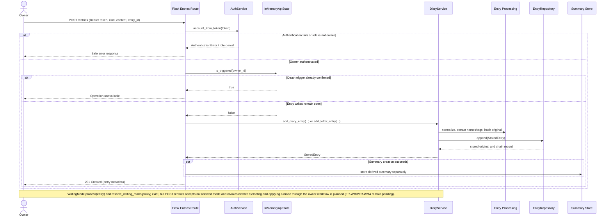

# ENNOVA Sequence Diagrams

These sequences follow the implemented Flask routes and service calls. The first shows the actual save path and marks the selected-writing-mode step as planned because no owner API currently connects a selected mode to entry creation.

## Planned selected-writing-mode workflow (not wired into the API)

```mermaid
sequenceDiagram
    actor Owner
    participant UI as Owner interface (not implemented)
    participant API as Entries route (mode input planned)
    participant Diary as DiaryService
    participant Repo as EntryRepository
    participant Registry as Writing-mode registry
    participant Mode as WritingMode strategy
    participant Store as InMemoryDerivedVersionStore

    Owner->>UI: Enter original and select Verbatim, LightFix, or Review
    UI->>API: Planned create request with mode name
    Note over UI,API: No owner interface exists and POST /entries currently accepts no mode name.
    API->>Diary: add_diary_entry(...)
    Diary->>Repo: append StoredEntry with original text and hash
    Repo-->>Diary: StoredEntry
    Diary-->>API: StoredEntry
    API->>Registry: get_writing_mode(mode_name)
    Registry-->>API: WritingMode instance
    API->>Mode: process(StoredEntry)
    Mode-->>API: immutable DerivedVersion linked to source digest
    API->>Store: append(version, sequence_number)
    Store-->>API: StoredDerivedVersion
    API-->>UI: Original remains saved; return derived version for comparison
```

`WritingMode`, `Verbatim`, `LightFix`, `Review`, `DerivedVersion`, and `InMemoryDerivedVersionStore` are implemented and tested as domain components. The UI participant, mode-bearing request, and route wiring in this diagram are planned; this is not the current runtime sequence.

## Owner creates and saves an entry



The saved original remains the source of the hash chain. Summaries are stored separately; a summary failure is swallowed by the route and does not overwrite the original.

## Registered beneficiary asks a question

```mermaid
sequenceDiagram
    actor Beneficiary as Registered beneficiary
    participant API as Flask Ask Route
    participant Auth as AuthService
    participant State as InMemoryApiState
    participant Facts as App facts builder
    participant QA as GroundedQAService
    participant Diary as DiaryService / EntryRepository
    participant Prolog as PrologAccessBridge
    participant Tools as Permission-filtered tools
    participant Model as ModelClient (Ollama or fake)

    Beneficiary->>API: POST /ask (Bearer token, question)
    API->>Auth: account_from_token(token)
    alt Authentication fails
        Auth-->>API: AuthenticationError
        API-->>Beneficiary: Safe authentication error
    else Authenticated beneficiary
        API->>State: active_policy(owner_id)
        alt Model or active policy unavailable
            API-->>Beneficiary: Neutral reply, no citations
        else Model and policy available
            API->>Facts: build_app_facts(owner_id)
            API->>QA: answer(question, fixed person_id, policy, facts, today)
            QA->>QA: Parse policy and build per-entry, per-level requests
            QA->>Diary: list_entries(owner_id) to enumerate candidate records
            Note over QA,Diary: This implementation enumerates owner-scoped records before Prolog; it does not send entry text to the model at this step.
            QA->>Prolog: evaluate_many(policy, facts, access and letter requests)
            Prolog-->>QA: allow/deny per level; letter statuses
            QA->>QA: Resolve highest allowed level per entry
            alt No permitted entries
                QA-->>API: Neutral reply (model is not called)
                API-->>Beneficiary: Neutral reply, no citations
            else One or more entries permitted
                loop Each permitted record only
                    QA->>QA: Verify entry integrity after authorization
                end
                alt All permitted records tampered
                    QA-->>API: Safe tamper response
                    API-->>Beneficiary: Safe error response
                else Verified permitted records exist
                    QA->>Tools: Create fixed-asker ToolContext with permissions
                    QA->>Model: Prompt with question and instructions (no raw vault dump)
                    loop Bounded tool-call loop
                        Model-->>QA: Tool request or candidate answer
                        opt Tool request
                            QA->>Tools: Run search/get/count/letter tool
                            Tools->>Tools: Enforce resolved level and verification
                            Tools-->>QA: Permitted view or neutral result only
                            QA->>Model: Tool result for permitted records only
                        end
                    end
                    Model-->>QA: Answer and citation identifiers
                    QA->>QA: Validate answer and attach permitted citations
                    QA-->>API: GroundedResponse
                    API-->>Beneficiary: Answer, citations, optional letter disclaimer
                end
            end
        end
    end

    Note over QA,Model: Entries with deny/no permission are skipped during integrity verification and are never returned by tools or included in model prompts/results.
    Note over API,Model: Prolog, parsing, or model failures follow fail-closed handling; model failures become a typed unavailable response.
```

The service currently calls `list_entries` to form requests before asking Prolog. The authorization boundary is applied before entry verification for retrieval tools and before any content is supplied to the model. Tests assert that denied entry contents do not reach model prompts or tool results. This ordering is a notable difference from a literal “authorize before any repository retrieval” interpretation of the proposal.

## Access denial and no relevant records

```mermaid
sequenceDiagram
    participant QA as GroundedQAService
    participant Prolog as PrologAccessBridge / SWI-Prolog
    participant Tools as Permission-filtered tools
    participant Model as ModelClient
    participant Caller as Ask Route

    QA->>Prolog: Evaluate candidate entry requests
    Prolog-->>QA: deny for all requested levels
    QA->>QA: Map all entries to no permission
    QA-->>Caller: Neutral reply without calling model

    Note over QA,Caller: If some entries are permitted but tools find no relevant records, the service returns the same neutral reply. Prolog or model failure also cannot grant access; Prolog failures deny and model failures use the supported typed unavailable path.
```
