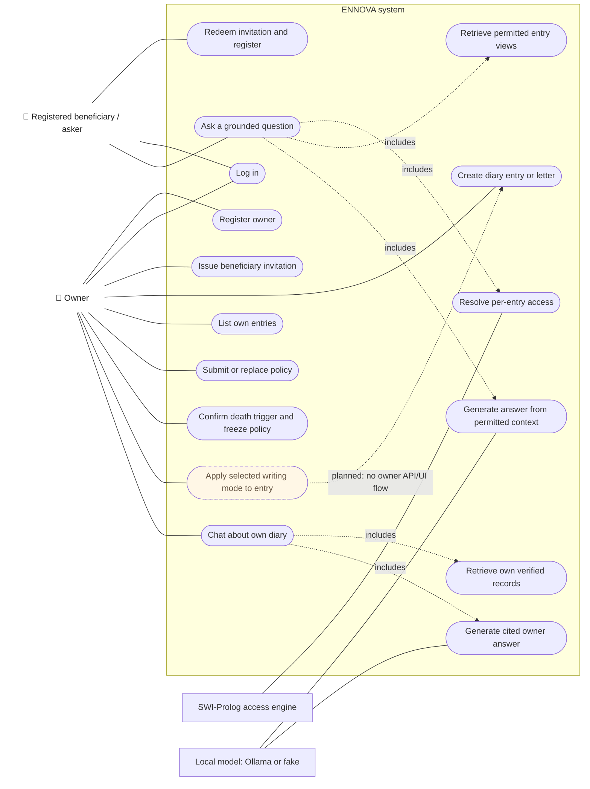

# ENNOVA Use Case Diagram

This diagram shows the supported actor interactions at the Flask API boundary and the external components used by backend workflows. The trustee is not shown as an actor because the finalized requirements assign no actions or reading rights to a trustee.

The owner and registered beneficiary use a standing-person symbol as the actor figure, while the system boundary contains ENNOVA use cases. The owner chatbot and beneficiary Q&A are separate: owner questions retrieve only the authenticated owner's verified records and do not call Prolog; beneficiary questions pass through Prolog authorization and send only permitted tool results to the model. Owner conversation context is temporary and owner-bound. The `/entries` endpoint supports owner-created diary entries and letters, and the writing-mode classes can derive immutable versions. However, the API does not accept a selected mode or call the mode registry when saving an entry; that owner-facing workflow remains planned. Policy `trustee is` and `transfer custody` statements are parsed into facts, but trustee administration is not an implemented interaction.
