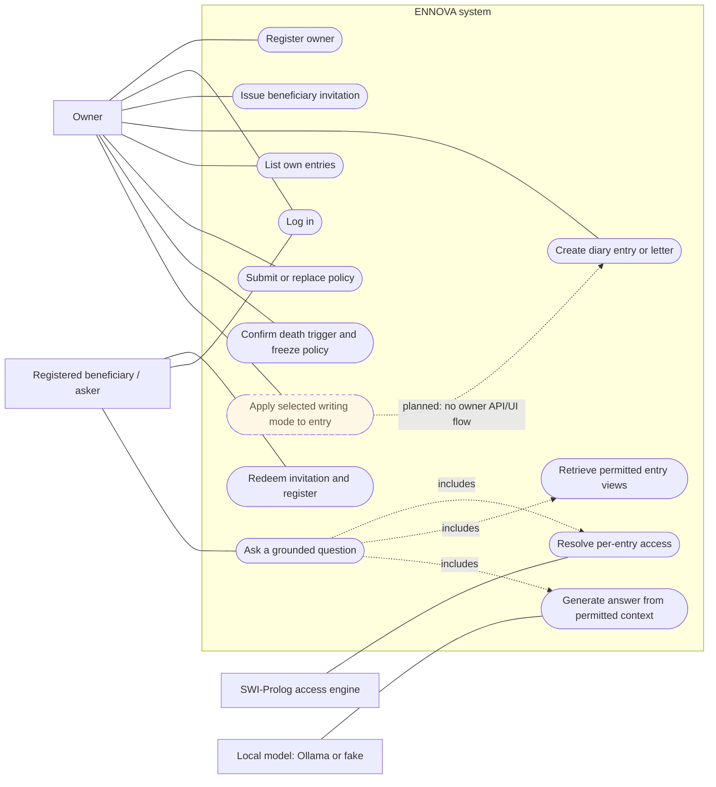

# ENNOVA Use Case Diagram

This diagram shows the supported actor interactions at the Flask API boundary and the external components used by backend workflows. The trustee is not shown as an actor because the finalized requirements assign no actions or reading rights to a trustee.

The `/entries` endpoint supports owner-created diary entries and letters, and the writing-mode classes can derive immutable versions. However, the API does not accept a selected mode or call the mode registry when saving an entry; that owner-facing workflow remains planned. Beneficiary questions pass through Prolog authorization, and the model receives only permitted tool results. Owner Q&A is not implemented and returns the neutral reply. Policy `trustee is` and `transfer custody` statements are parsed into facts, but trustee administration is not an implemented interaction.
